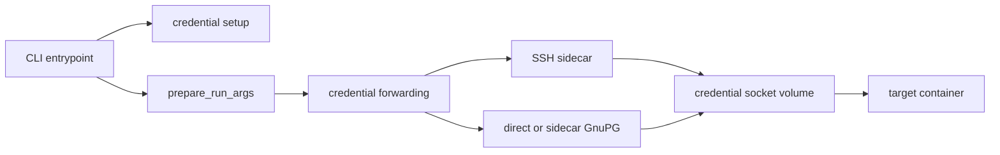

# Review Report

## Overview

Reviewed `de1beed4` against `de1beed4^`. The change introduces persistent credential-agent sidecars for SSH and
fallback GnuPG forwarding, platform-keyring reload support, target-private-key isolation, and corresponding unit and
Docker integration coverage.

## Verdict

🟡 YELLOW — the sidecar architecture and isolation boundary are sound, but direct protected-GnuPG preparation breaks
the required noninteractive contract and credential-image setup is repeated within a single run.

### Concerns

1. `src/aicage/runtime/credential_agent/_gpg_forwarding.py:113` — `_prepare_direct_gpg_keys()` runs `gpg --detach-sign`
   without `--batch`, a loopback pinentry configuration, or a keyring lookup. `ensure_gpg_setup()` calls it even for
   `interactive=False` (`forwarding.py:122-136`). A cold protected host key can therefore trigger pinentry or block a
   noninteractive run instead of failing before target startup with the documented missing-secret error. The existing
   direct protected-key integration test deliberately pre-caches the key, so it cannot exercise this case.
2. `src/aicage/cli/entrypoint.py:97-104` first resolves the credential image explicitly, then
   `ensure_credentials()` resolves it again per selected sidecar through `_ensure_sidecars()`
   (`forwarding.py:103-143`, `_sidecars.py:13-29`), and `prepare_run_args()` resolves it again through `forwarding()`.
   With SSH plus fallback GnuPG this can make four digest/setup checks in one invocation. Direct-GnuPG-only runs also
   perform the initial credential-image setup despite requiring no sidecar. This conflicts with the one shared image
   resolution required by the task.

## Impact Diagram

## Change Set

- Base: `de1beed4^` (`065d0991`)
- Head: `de1beed4`
- Files: 96 changed; 5,891 additions and 669 deletions.
- Structural path analysis: 39 call edges added and 34 removed among the first 25 changed symbols; no retargeted
  edges reported.

## Changes

- Adds the private `runtime.credential_agent` package for resource lifecycle, SSH/GnuPG forwarding, and native
  keyring access.
- Adds credential-image verification/pull support and volume mount argument support.
- Removes the old direct SSH-key/GnuPG resolver path and moves credential preparation ahead of target startup.
- Adds focused unit tests and Linux/Windows-oriented integration coverage, but lacks coverage for a cold protected
  direct GnuPG key in noninteractive mode and end-to-end image-resolution call counts.

## Blast Radius

- `forwarding` has five direct callers in the graph, all targeted credential tests or credential integration tests.
- `prepare_run_args` is reached from the normal CLI and one OpenRouter ACP test script; its added behavior is covered
  by dedicated run-plan tests.

## Communities

The implementation spans the runtime forwarding, Docker execution, registry image verification, CLI lifecycle, and
integration-test communities. The dependency direction remains appropriate: the public coordinator owns orchestration
while protocol and resource mechanics stay in private modules.

## Policy Findings

No policy file is configured, so no policy gate was run. `git diff --check de1beed4^ de1beed4` passed.

## Test Handoff

- Passed locally: `pytest --cov=src --cov-report=term-missing` — 1036 passed, 50 skipped, 94% total coverage.
- The 50 skipped cases are Docker-dependent integration tests, including the new SSH/GnuPG forwarding suites; they
  require their intended Linux/Windows CI environments for live execution.
- Before merging, add a noninteractive direct-GnuPG test with an uncached protected key and an entrypoint-level test
  proving one credential-image resolution per invocation.

## Sources

- `doc/ai/task/42/README.md`
- `doc/ai/task/42/IMPLEMENTATION_PLAN.md`
- `doc/ai/task/42/TEST_COVERAGE.md`
- `doc/python-test-structure-guidelines.md`
- `AGENTS.md`
